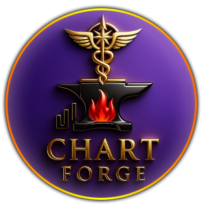
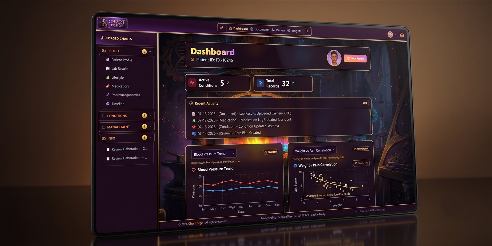
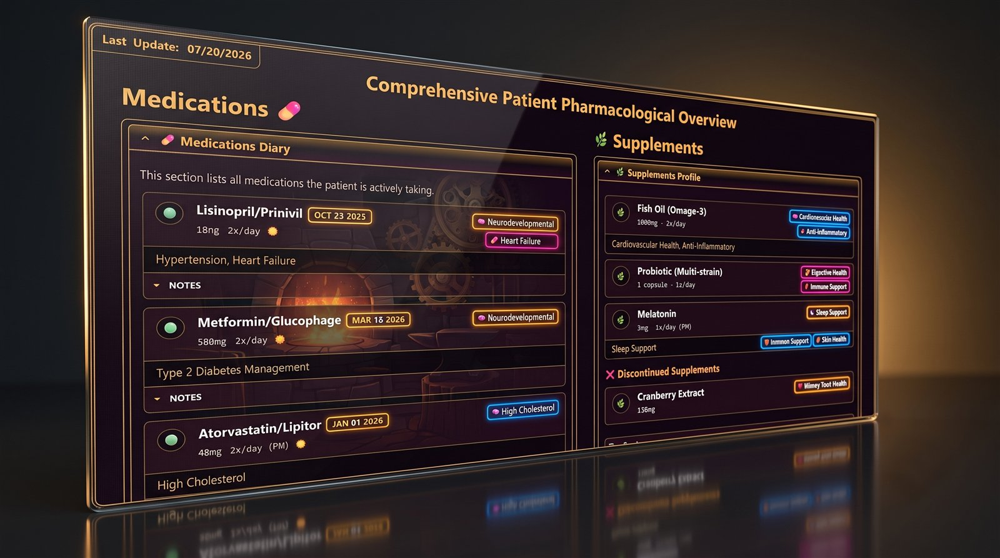
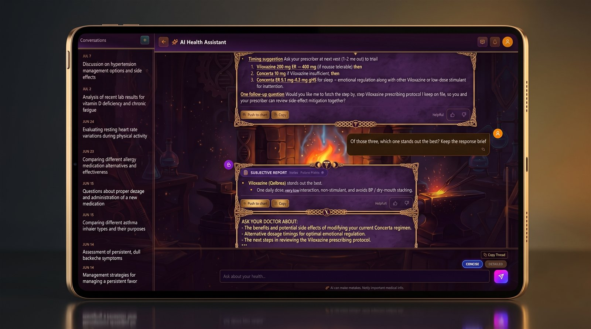
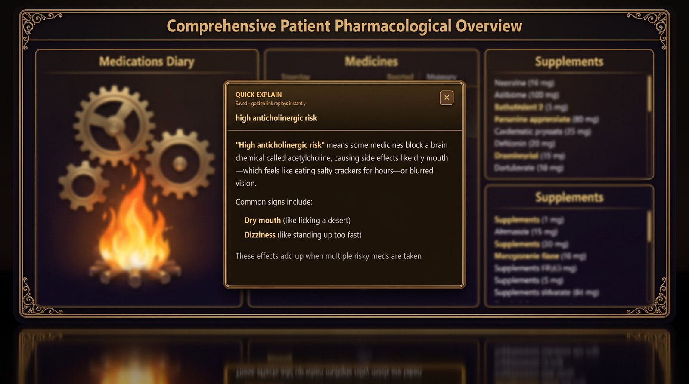

<!-- Public README: high-level showcase for ChartForge. Keep public, polished, and free of patient data. -->

  

  <h1>⚒️ ChartForge</h1>

  
<a href="index.html"><strong>Open the formatted HTML preview</strong></a> (looks better than this markdown page).

  

    <strong>Patient-controlled health records with built-in AI</strong> 
    A modern, privacy-first platform for organizing medical history, generating insights, and planning next steps.
  

  

    
    
    
    
    
  

  

    
    
    
  

 

  
  
<em>🏠 Dashboard · conditions, activity, and trend charts at a glance</em>

---

## 🚀 Elevator Pitch

ChartForge turns a personal medical chart into a living, intelligent system. It helps patients and advocates collect structured records, summarize complex histories, visualize trends, and prepare better questions for clinicians.

The core rule is simple: **🤖 AI can propose, but 👤 humans decide.** The assistant can draft a chart update, explain a term, or summarize a thread, but edits go through review before they become part of the record.

---

## ❓ Why This Project Exists

Traditional patient records are scattered across portals, PDFs, visit notes, screenshots, and memory. ChartForge gives those fragments a usable home:

- 🗂️ Ownership and control of the health record
- 📚 Rich, structured documentation that stays readable
- 🤖 A chart-aware AI assistant for summaries, explanations, and draft updates
- 📈 Visual trends for vitals, symptoms, and progress over time
- 🛡️ Review gates so automation cannot silently rewrite the chart

---

## 🎯 Who It’s For

- 🧍 Patients and advocates managing complex, multi-year health journeys
- 🩺 Care teams that need cleaner summaries before visits
- 🛠️ Builders interested in privacy-aware AI, clinical UX, and patient-owned records
- 💼 Employers looking for full-stack product execution with real-world safety constraints

---

## ✨ Highlights

- 👑 **Patient-Controlled Chart**: The patient owns the record. AI helps read, summarize, and draft, but approved users decide what changes.
- 🧱 **Documents as Building Blocks**: Profile, condition, management, and reference pages render through clinical layouts instead of raw markdown.
- 🤖 **Chart-Aware AI Assistant**: Chat can answer from the chart, keep context across a long thread, and send useful output to review.
- ✅ **Review Before Write**: Proposed chart edits are queued, diffed, and applied only after a human approves them.
- 🔎 **Insights Queue**: Separate scans flag stale items, conflicts, and gaps for approve, archive, or promote-to-chart workflows.
- 💊 **Medication + PGx Views**: Medication, supplement, and pharmacogenomics pages use purpose-built layouts for faster review.
- 📊 **Trends and Correlations**: Vitals and symptom metrics can render as focused charts.
- 🔒 **Privacy-First Design**: Patient scope, role checks, row-level security, and tokenized AI calls are built into the architecture.

---

## 📸 Screenshots

<strong>A closer look at the product surfaces</strong>

<table>
  <tr>
    <td align="center" width="50%">
      
       
      🏠 <b>Dashboard</b> · metrics, activity, and trends
    </td>
    <td align="center" width="50%">
      
       
      💊 <b>Medications</b> · diary, supplements, pillar tags
    </td>
  </tr>
  <tr>
    <td align="center" width="50%">
      
       
      🤖 <b>AI Chat</b> · chart-aware answers with review actions
    </td>
    <td align="center" width="50%">
      
       
      💡 <b>Quick Explain</b> · plain-language term popups
    </td>
  </tr>
</table>

---

## 🔑 Core Features

| Feature | Description |
|---------|-------------|
| 🏠 **Patient Dashboard** | Active conditions, record counts, recent activity, and trend cards for the linked patient. |
| 📄 **Clinical Documents** | Profile, condition, management, and reference pages rendered with layout-aware components. |
| 🤖 **AI Chat** | Full-page and sidebar chat grounded in the patient chart, with concise or detailed response modes. |
| ✅ **Review Queue** | AI-proposed edits are listed, reviewed, and applied only on approval. |
| 🔎 **Insights** | Background scans surface gaps, conflicts, stale data, and follow-up opportunities. |
| 💊 **Medications + PGx** | Medication, supplement, and pharmacogenomics views built for quick clinical scanning. |
| 📊 **Charts** | Vitals, symptoms, and relationship charts through reusable visualization components. |
| 🛠️ **Admin Tools** | Invites, user roles, patient linking, sync checks, restore points, and feedback moderation. |

---

## 🛠️ Tech Stack

- ⚛️ **Frontend**: Next.js 16 App Router, React 19, TypeScript
- 🎨 **Styling**: Tailwind CSS 4, project design tokens, reusable clinical layouts
- 🗄️ **Data + Auth**: Supabase, PostgreSQL, Google OAuth, row-level security
- 🧠 **AI**: Vercel AI SDK, OpenRouter models, optional web research
- 📝 **Content**: Markdown documents, frontmatter, Mermaid diagrams
- 📦 **State + Validation**: Zustand, Zod
- 📉 **Charts**: Recharts
- 🧪 **Testing**: Vitest

---

## 🏗️ Architecture at a Glance

- 🔐 **Patient-scoped runtime**: Authenticated users see only the chart they are linked to, unless an admin role allows wider operation.
- 📚 **Document-first model**: The chart stays readable as structured documents while the app renders richer layouts on top.
- 🎯 **Direct chart grounding**: Chat loads prioritized chart context directly instead of depending on a patient-chart vector database.
- 🧑‍⚖️ **Human review loop**: Chart-writing actions flow through review so AI output stays inspectable.
- 🛡️ **Operational safety**: Admin sync, restore, feedback, and role tooling are first-class surfaces.

---

## 🚦 Current Status

ChartForge is actively developed. The current focus is hardening review flows, improving reference-grounded answers, expanding medication and pharmacogenomics views, and keeping the interface fast enough for everyday chart work.

---

## 💼 Differentiators

- ❤️ **Patient-first product thinking**: Built around how patients and advocates actually collect, explain, and use health records.
- 🛡️ **Safety-aware AI**: The assistant is helpful by design, but not allowed to silently modify the record.
- 🧬 **Real clinical density**: Medication lists, timelines, PGx, metrics, and narrative notes live in one navigable system.
- ⚙️ **Modern full-stack execution**: Next.js, Supabase, AI streaming, admin workflows, and testable safety gates in one product.
- ✨ **Polished UX direction**: Rich visuals without losing the calm, readable feel needed for clinical content.

---

## 🤝 Contact

💬 Questions or ideas: open an issue on this repository.
