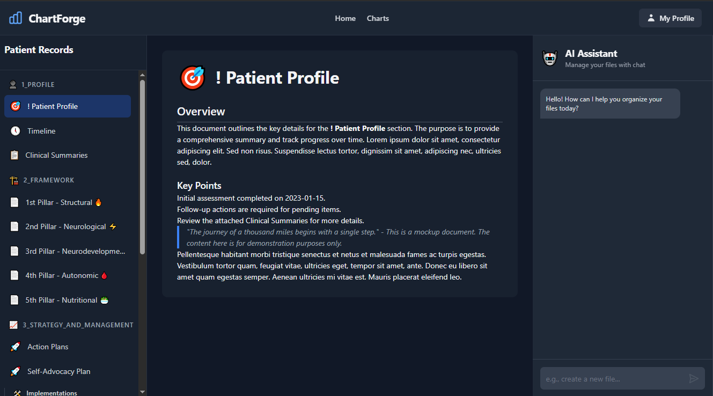

<!-- Public README: High-level overview and pitch for ChartForge (MedChart v2). Use this file on GitHub to showcase the project to visitors and employers. -->
<div align="center">
  
  <h1>ChartForge</h1>
  <p><strong>Patient‑controlled health records with built‑in AI</strong> — a modern, privacy‑first, developer‑friendly platform for organizing medical history, generating insights, and planning next steps.</p>
  
  [](https://nextjs.org/)
  [](https://www.typescriptlang.org/)
  [](https://tailwindcss.com/)
  [](https://supabase.com/)
  [](https://opensource.org/licenses/MIT)
  
</div>

## 🚀 Elevator Pitch
ChartForge turns a personal medical chart into a living, intelligent system. It helps patients (and their care teams) collect structured data, summarize complex histories, visualize trends, and generate actionable plans — all within a calm, fast, and accessible UI. Built with Next.js, TypeScript, Tailwind, and shadcn/ui; designed for extensibility from scrappy MVP to HIPAA‑grade deployments.

## ❓ Why This Project Exists
Traditional EMRs can be closed, slow, and clinician‑centric. ChartForge is patient‑centric. It enables:
- Ownership and control of your health data
- Rich, structured documentation you can actually use
- An AI assistant that helps you summarize, categorize, and plan
- A 7‑pillar/clinical management model to organize complex health domains

## 🎯 Who It’s For
- Patients and advocates managing complex, multi‑year health journeys
- Clinicians and coaches who want structured, AI‑augmented summaries
- Researchers and data nerds who care about clean schemas and reproducible workflows
- Employers looking for modern full‑stack execution with thoughtful UX, architecture, and documentation

## ✨ Highlights (New Direction)
- 👑 **Patient‑Controlled Chart**: You control the record; AI helps edit, search, and summarize.
- 🏛️ **Pillars Framework**: Organize health into pillars (Structural, Neurological & Autonomic, Mental & Psychological, Heart, Nutritional, Environmental & Occupation, Social & Relations).
- 🧱 **Documents as Building Blocks**: Rich editor with sections and blocks (Key Points, Executive Summary, Evidence, Timeline links, etc.).
- 🤖 **AI Assistant (Right Rail)**: Summarize, extract key points, create Action Plans, and maintain per‑patient knowledge.
- 🔍 **Search/RAG**: Fast, faceted search with vector embeddings for medical notes and evidence.
- 📊 **Timeline + Visualizations**: See progress with charts and timeline events.
- 🔒 **Privacy‑Ready**: Supabase row‑level security, encryption at rest (planned), audit logging.
- 📱 **Mobile‑first and Accessible**: Calm UI, fast interactions, sensible defaults.

## 📸 Screenshot
<div align="center">
  
</div>

## 🔑 Core Features
| Feature | Description |
|---------|-------------|
| **Patient Profile** | Overview, demographics, labs, lifestyle, medications & genetics, timeline. |
| **Documents** | Viewer/editor with sections, blocks, ingest/import from templates. |
| **AI Tools** | Chat, summarize, key points, action plans, RAG search. |
| **Pillars** | Dedicated components per pillar with evidence-level indicators. |
| **Management Layer** | Action Plans, Clinical Roadmap, and Self‑Improvement plans. |
| **Charts** | Vitals, trends, and progress visualizations. |
| **Search & Filters** | Pillar, evidence level, date, saved searches. |

## 🛠️ Tech Stack
- **Frontend**: Next.js (App Router), TypeScript, TailwindCSS, shadcn/ui, Tiptap
- **Data & Auth**: Supabase, Prisma, PostgreSQL
- **AI & Search**: Embeddings, RAG, custom ranking (planned & in‑progress per blueprint)
- **Tooling**: ESLint, PostCSS, Jest/Vitest (planned), Scripts for imports/embeddings/backup

## 🏗️ Architecture at a Glance
- **Modular Components**: `src/components` structured by domain (patient, document, timeline, charts, management, ui).
- **App Routes**: RESTful API routes under `src/app/api` for patients, documents, sections, blocks, AI, embeddings, and timeline.
- **Types & Validation**: Strong TypeScript types + Zod validation planned to ensure consistency across UI and API.
- **Styles**: Global + component styles with Tailwind/shadcn; themed variants ready for dark/light/medical contexts.
- **Utilities & Hooks**: Centralized helpers (`src/utils`, `src/hooks`) and context stores for state.

See `logs/IMPLEMENTATION_BLUEPRINT.md` for a detailed, buildable map of pages, endpoints, components, and phases.

## 🚀 Getting Started
1.  **Requirements**: Node 18+, pnpm or npm, local PostgreSQL (optional for MVP), Supabase (optional).
2.  **Install**: 
    ```bash
    npm install
    ```
3.  **Develop**:
    ```bash
    npm run dev
    ``` 
    Then open http://localhost:3000
4.  **Environment**: copy `.env.example` (when available) to `.env.local`; configure Supabase/DB for advanced features.

Note: This repo includes a strong foundation and staged features. Some endpoints/components are stubbed or in progress per the blueprint phases.

## 🗺️ Roadmap (from logs)
- **Phase 0**: Foundation — data structures, basic editing, patient/doc CRUD, navigation.
- **Phase 1**: Search — full‑text + embeddings, faceted filters, saved searches.
- **Phase 2**: Mobile/responsive enhancements, action plans & management, performance.
- **Phase 3**: Auth & Protected Routes — login, magic link, profiles, admin panel (future).
- **Ongoing**: Security, audit logging, data export/deletion, encryption for sensitive fields.

## 💼 Differentiators for Employers
- **Product Thinking**: **Patient‑first**, practical MVP to **HIPAA‑grade path**.
- **Architecture**: Clear **separation of concerns**, typed models, **modular UI**.
- **Performance & UX**: **Calm UI**, standardized components, **measured optimizations** (see `logs/opimizitron_reports/`).
- **Documentation**: **Plans, blueprints, and session logs** that show deliberate iteration and decision-making.
- **Maintainability**: **Centralized UI and styles**, utility scripts, and **consistent conventions**.

## 🤝 Contributing / Contact
This is an open, evolving project. Ideas and PRs are welcome once the public repo is established.
- **Contact**: Reach out via GitHub issues
